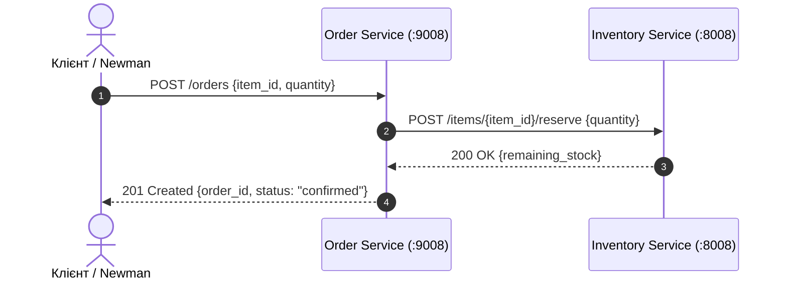

# stps-lab1-microservices-n8

Мікросервісна взаємодія на FastAPI та Docker Compose (варіант 8: порти `8008` та `9008`).

## UML-діаграма послідовності


## Запуск
```bash
docker compose up --build -d
```
